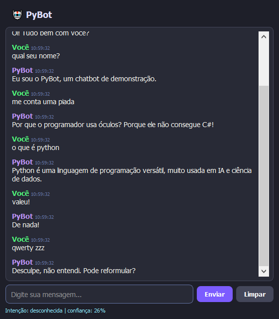
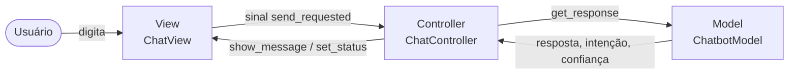

# 🤖 PyBot — Chatbot com Scikit-learn e PyQt5

Projeto **didático** que implementa um chatbot simples baseado em **classificação de intenções** com aprendizado de máquina, usando **Scikit-learn** para o modelo de IA e **PyQt5** para a interface gráfica. O código é organizado com **Programação Orientada a Objetos** e segue o padrão **MVC (Model–View–Controller)**.



---

## 📋 Sumário

- [Funcionalidades](#-funcionalidades)
- [Como a IA funciona](#-como-a-ia-funciona)
- [Arquitetura MVC](#-arquitetura-mvc)
- [Estrutura do projeto](#-estrutura-do-projeto)
- [Instalação](#-instalação)
- [Execução](#-execução)
- [Tutorial: ensinando algo novo ao bot](#-tutorial-ensinando-algo-novo-ao-bot)
- [Ajustes e experimentos](#-ajustes-e-experimentos)
- [Limitações](#-limitações)

---

## ✨ Funcionalidades

- Conversa em português com reconhecimento de intenções (saudação, despedida, piadas, perguntas sobre IA/Python etc.).
- Tolerância a acentos, maiúsculas e pequenos erros de digitação.
- Resposta padrão quando a mensagem não é compreendida.
- Interface gráfica com **registro do diálogo** (remetente e horário de cada mensagem).
- Barra de status mostrando a **intenção detectada** e a **confiança** do modelo.
- Botão para limpar o histórico.

---

## 🧠 Como a IA funciona

O chatbot resolve um problema de **classificação de texto supervisionada**:

```
Mensagem do usuário
        │
        ▼
1. Pré-processamento   → minúsculas + remoção de acentos  ("Olá!" → "ola!")
        │
        ▼
2. Vetorização TF-IDF  → transforma o texto em números usando n-gramas
                          de caracteres (2 a 4 letras)
        │
        ▼
3. Regressão Logística → calcula a probabilidade de cada intenção
        │
        ▼
4. Decisão             → se confiança ≥ 40%: resposta aleatória da intenção
                          senão: "Desculpe, não entendi..."
```

| Conceito | Papel no projeto |
|---|---|
| **TF-IDF** | Dá mais peso aos trechos de texto que distinguem uma intenção das outras. |
| **N-gramas de caracteres** | Permitem reconhecer "piadinha" ou "obrigadoo" mesmo sem estarem no treino. |
| **Regressão Logística** | Classificador leve e rápido, ideal para poucos dados. |
| **Limiar (threshold)** | Evita respostas erradas para entradas sem sentido. |

O modelo é **treinado a cada inicialização** a partir de `data/intents.json` — leva menos de um segundo.

---

## 🏛️ Arquitetura MVC



| Camada | Classe(s) | Responsabilidade |
|---|---|---|
| **Model** | `ChatbotModel`, `IntentClassifier`, `TextPreprocessor`, `Message` | Dados, treino, predição e histórico. Não conhece a interface. |
| **View** | `ChatView` | Exibe a janela e emite sinais (`send_requested`, `clear_requested`). Não contém lógica. |
| **Controller** | `ChatController` | Recebe eventos da View, consulta o Model e atualiza a View. |
| **App** | `App` (`main.py`) | Cria e conecta as três camadas. |

---

## 📁 Estrutura do projeto

```
chatbot/
├── main.py                        # Ponto de entrada (classe App)
├── requirements.txt               # Dependências
├── README.md
├── data/
│   └── intents.json               # Base de treino: intenções, frases e respostas
├── models/
│   └── chatbot_model.py           # Model (IA + histórico)
├── views/
│   └── chat_view.py               # View (PyQt5)
├── controllers/
│   └── chat_controller.py         # Controller
└── docs/
    └── screenshot.png
```

---

## ⚙️ Instalação

**Pré-requisito:** Python 3.10 ou superior.

> 💡 Use um **ambiente virtual** para não alterar os pacotes globais do seu Python
> (o Scikit-learn pode atualizar o NumPy e quebrar outros projetos).

```powershell
cd chatbot

# 1. Criar o ambiente virtual
python -m venv .venv

# 2. Instalar as dependências
.\.venv\Scripts\python -m pip install -r requirements.txt
```

No Linux/macOS, use `.venv/bin/python` no lugar de `.\.venv\Scripts\python`.

---

## ▶️ Execução

```powershell
.\.venv\Scripts\python main.py
```

Experimente digitar:

| Você digita | Intenção esperada |
|---|---|
| `oi, bom dia` | saudacao |
| `qual seu nome?` | nome |
| `me conta uma piada` | piada |
| `o que é inteligência artificial` | ia |
| `valeu!` | agradecimento |
| `asdfgh` | *(não entendeu)* |

---

## 🎓 Tutorial: ensinando algo novo ao bot

Vamos ensinar o PyBot a responder sobre **o clima**.

### Passo 1 — Adicione uma intenção

Abra `data/intents.json` e acrescente um novo objeto na lista `"intents"` (atenção à vírgula entre os objetos):

```json
{
  "tag": "clima",
  "patterns": [
    "como está o tempo",
    "vai chover hoje",
    "está fazendo calor",
    "previsão do tempo",
    "está frio"
  ],
  "responses": [
    "Não tenho acesso à previsão, mas espero que esteja um dia lindo!",
    "Melhor conferir um app de meteorologia. Leve um guarda-chuva por precaução! ☂️"
  ]
}
```

- **tag** — nome único da intenção (o rótulo da classe).
- **patterns** — exemplos de frases do usuário (dados de treino). Quanto mais variados, melhor.
- **responses** — respostas possíveis; uma é sorteada a cada vez.

### Passo 2 — Reinicie o aplicativo

```powershell
.\.venv\Scripts\python main.py
```

O modelo é retreinado automaticamente com a nova intenção.

### Passo 3 — Teste

Digite `será que chove amanhã?`. Mesmo sem essa frase exata no treino, o bot deve reconhecer a intenção **clima** — observe a confiança na barra de status.

### Passo 4 — Teste o modelo pelo terminal (opcional)

Útil para depurar sem abrir a interface:

```powershell
.\.venv\Scripts\python -c "from models.chatbot_model import ChatbotModel; m = ChatbotModel('data/intents.json'); print(m.get_response('será que chove amanhã?'))"
```

A saída é uma tupla `(resposta, intenção, confiança)`.

> 💡 **Dica:** se a confiança estiver baixa, adicione mais exemplos em `patterns`.
> Intenções com frases muito parecidas entre si tendem a se confundir.

---

## 🔧 Ajustes e experimentos

Ideias para estudar alterando `models/chatbot_model.py`:

| O que mudar | Onde | Efeito |
|---|---|---|
| Limiar de confiança | `IntentClassifier(threshold=0.40)` | Menor = responde mais (e erra mais); maior = mais "Não entendi". |
| N-gramas | `ngram_range=(2, 4)` | Faixas maiores capturam mais contexto. |
| Tipo de análise | `analyzer="char_wb"` | Troque por `"word"` para usar palavras inteiras e compare. |
| Classificador | `LogisticRegression(...)` | Teste `sklearn.svm.LinearSVC` ou `sklearn.naive_bayes.MultinomialNB` (ajustando o uso de `predict_proba`). |

---

## ⚠️ Limitações

- O bot **não tem memória de contexto**: cada mensagem é classificada isoladamente.
- As respostas são **fixas** (escolhidas de uma lista), não geradas.
- A qualidade depende diretamente da quantidade e variedade dos exemplos em `intents.json`.

Para chatbots mais avançados, os próximos passos naturais seriam redes neurais (TensorFlow/PyTorch), extração de entidades e modelos de linguagem (LLMs).

---

## 📦 Dependências

| Pacote | Uso |
|---|---|
| [scikit-learn](https://scikit-learn.org/) | Vetorização TF-IDF e Regressão Logística |
| [PyQt5](https://pypi.org/project/PyQt5/) | Interface gráfica |

---

*Projeto criado para fins de demonstração e estudo.*
